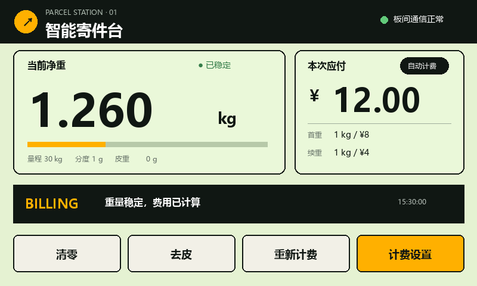
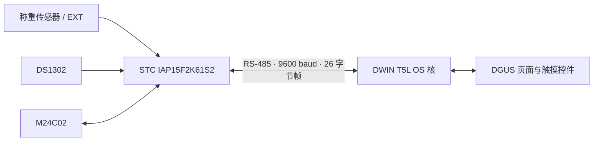

# 智能快递终端（STC + DWIN）

基于 STC 主控、称重模块、RS-485 与 DWIN T5L 触摸屏的课程实训项目。仓库同时包含两端固件、DGUS 页面资源、可直接烧录的发布文件、协议说明和联调文档。



## 功能概览

- 读取称重传感器数据，支持清零、去皮与标定；
- 按省内、普通省外、偏远地区三档规则模拟计费；
- STC 与 DWIN 通过 9600 baud RS-485 定长帧通信；
- DWIN 显示重量、价格、地区、系统状态与 DS1302 时间；
- 控制命令支持 ACK/NACK、超时重试和序号去重；
- 地区设置保存在 STC 板载 M24C02 中。

## 系统结构



## 仓库目录

```text
.
├─ firmware/
│  ├─ stc/                 # STC 主控 Keil C51 工程
│  │  ├─ source/           # 业务源码
│  │  ├─ inc/              # 项目头文件、芯片头文件与课程 BSP 接口
│  │  ├─ lib/              # 课程 BSP 库
│  │  ├─ release/          # 已验证的 STC HEX
│  │  └─ tests/            # 可在主机运行的计费边界测试
│  └─ dwin/                # DWIN T5L OS + DGUS 工程
│     ├─ user/             # 项目业务逻辑
│     ├─ driver/ 与 sys/   # DWIN 示例底座及驱动
│     ├─ DWIN_SET/         # 可复制到 SD 卡的屏幕下载包
│     ├─ TFT/              # DGUS 工程辅助文件
│     └─ tools/            # 页面补丁和 HEX 转 BIN 脚本
├─ docs/                   # 架构、协议、构建、排错与源码详解
└─ hardware/               # STC-B 学习板原理图
```

## 快速开始

### 1. 编译 STC 固件

1. 安装 Keil µVision 5（含 C51 工具链）。
2. 打开 `firmware/stc/parcel-terminal-stc.uvproj`。
3. 选择目标 `IAP15F2K61S2 / 20I-P44` 并构建。
4. 使用 STC-ISP，以 11.0592 MHz 下载频率烧录生成的 HEX。

仓库已提供一份已验证的 `firmware/stc/release/ParcelTerminal_STC.hex`。首次上电请先保持秤台空载并清零；当前默认使用原始计数模式，精确计量需要切换配置并用已知砝码标定。

### 2. 编译 DWIN OS 核

1. 打开 `firmware/dwin/parcel-terminal-dwin.uvproj`。
2. 构建工程。构建后脚本会调用 `tools/hex_to_bin.ps1`，把 Intel HEX 转为 `DWIN_SET/T5L51.bin`。
3. 如需编辑界面，用 DGUS Tool 打开 `firmware/dwin/DWprj.hmi` 并重新生成资源。
4. 若重新生成覆盖了地区设置页，按 `firmware/dwin/README.md` 的说明重新运行页面补丁。

### 3. 下载到 DWIN 屏

将 `firmware/dwin/DWIN_SET` 整个目录复制到 FAT32 格式 SD 卡根目录，断电插卡后重新上电，等待资源下载完成。完成后断电、拔卡并再次上电。

### 4. 连接与联调

- STC UART2 经板载 MAX485 连接 DWIN UART4；
- 两端均配置为 9600 baud，并共地；
- 先验证 STC 单独称重与 K1 清零，再连接屏幕验证双向控制；
- 若 K1 能清零但触摸按钮无效，优先检查 VP `0x1100` 和 DWIN → STC 方向的 RS-485 链路。

详细步骤见 [编译烧录与联调排错](docs/05_编译烧录与联调排错.md)，协议与 VP 映射见 [协议、VP 与计费规则](docs/04_协议VP与计费规则.md)。

## 测试

计费逻辑不依赖 8051 硬件，可使用 GCC 在仓库根目录运行：

```powershell
gcc -std=c99 -Ifirmware/stc/inc firmware/stc/source/billing.c firmware/stc/tests/test_billing.c -o billing-test.exe
./billing-test.exe
```

成功时输出 `billing region boundary tests passed`。

## 项目状态

- 两套 Keil 工程均使用相对路径，适合克隆后直接打开；
- 整理后的 STC 与 DWIN 工程已在 Keil C51 环境重新构建：STC 0 错误/9 个未调用 BSP 模块警告，DWIN 0 错误/0 警告；
- `DWIN_SET` 与 STC `release` 中保留了当前可烧录版本；
- 本仓库未包含 Keil、DGUS Tool、STC-ISP 等专有开发工具。

## 文档

从 [文档索引](docs/README.md) 开始阅读。推荐顺序为：整体架构 → STC 工程 → DWIN 工程 → 协议/VP → 联调排错。

## 许可与第三方内容

本仓库尚未声明开源许可证，默认保留全部权利。课程 BSP、芯片头文件、DWIN 示例底座和开发工具的权利归各自提供方所有；公开发布前请确认这些文件的再分发许可。详见 [NOTICE.md](NOTICE.md)。
